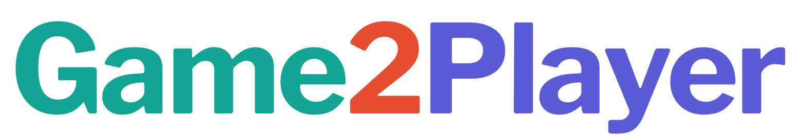
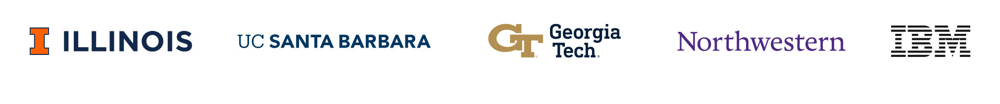
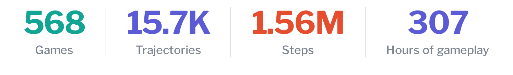
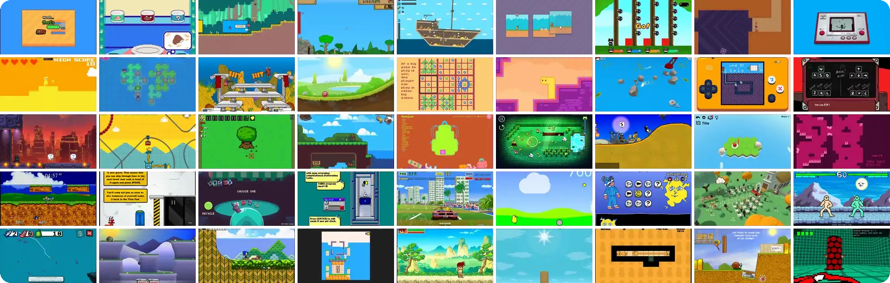
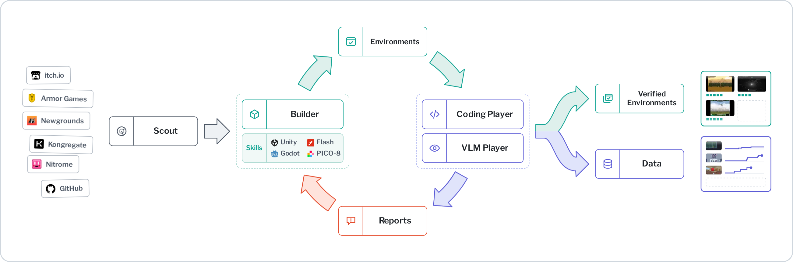

<div align="center">

<h3>
<br>
Scaling Gameplay Experience for Visual Agents<br>
through Environment–Player Co-Development
</h3>

<p>
Xirui Jiang<sup>1,*</sup>, Yuxi Chen<sup>1,*</sup>, Rui Yang<sup>1,*</sup>, Feng Luo<sup>2,*</sup>,<br>
Pengcheng Wang<sup>1</sup>, Bingxuan Li<sup>1</sup>, Zihao Zhao<sup>3</sup>, Yushan Li<sup>1</sup>, Han Wang<sup>1</sup>,<br>
Manling Li<sup>4</sup>, Yang Zhang<sup>5</sup>, Shiyu Chang<sup>2</sup>, Tong Zhang<sup>1</sup>, Huan Zhang<sup>1</sup>
</p>
<p>
<sup>1</sup> University of Illinois Urbana-Champaign &nbsp; <sup>2</sup> UC Santa Barbara<br>
<sup>3</sup> Georgia Institute of Technology &nbsp; <sup>4</sup> Northwestern University &nbsp; <sup>5</sup> IBM
</p>
<p><sup>*</sup> Equal contribution</p>

<p>

</p>

<p>
  
  <a href="https://game2player.github.io"></a>
  <a href="https://game2player.github.io/#leaderboard"></a>
  
  <a href="https://huggingface.co/game2player"></a>
</p>

<p>

</p>

</div>

<p align="center">
  
</p>

## Overview

Game2Player co-develops verifiable game environments with a Coding Player and a VLM
Player, and turns their gameplay into training data for visual agents. This repository
holds the framework: the agents that build environments from web games, the players,
the browser runtime, rollouts, data export and training.

<p align="center">
  
</p>

- **Scout** selects games by their source, engine and access to game state.
- **Builder** adapts each game for offline play, exposes its state through `game_api.js`,
  and defines verifiable tasks, with engine skills for Unity, Flash, Godot and PICO-8.
- **Coding Player** writes code policies that read the game state. **VLM Player** plays
  from screenshots.
- **Reports** return problems to the Builder, such as a key press with no effect or a
  state variable a policy needs. The Builder repairs the environment and the players retry.
- The loop produces **Verified Environments** and **Data**: trajectories that record
  observations, actions and task progress.

<br>

<table>
  <tr>
    <td width="33%" valign="top">
      <br>
      <b>Environment–player co-development</b><br>
      Co-develop verifiable game environments and code policies through gameplay feedback,
      with game-state-based tasks, progress measures and success checks.
    </td>
    <td width="33%" valign="top">
      <br>
      <b>Scalable collection and visual policy distillation</b><br>
      Fast code policy rollouts and VLM demonstrations train Game2Player-4B and
      Game2Player-9B with progress-weighted SFT.
    </td>
    <td width="33%" valign="top">
      <br>
      <b>PlayerBench</b><br>
      50 held-out games and 287 tasks, harder than GameWorld: Game2Player-4B with
      thinking on reaches 31.1 progress on PlayerBench and 49.5 on GameWorld.
    </td>
  </tr>
</table>

## Results

We fine-tune Qwen3.5-4B and Qwen3.5-9B on gameplay collected with Game2Player and test
them on PlayerBench (50 held-out games, 287 tasks) and GameWorld (34 games, 170 tasks).
Each model plays each task once, with at most 100 steps per task. Progress is averaged
over a game's tasks and then over games. Success is the share of tasks completed.

<table>
  <tr><th rowspan="2" align="left">Model</th><th rowspan="2">Thinking</th><th colspan="2">PlayerBench</th><th colspan="2">GameWorld</th></tr>
  <tr><th>Progress</th><th>Success</th><th>Progress</th><th>Success</th></tr>
  <tr><td>Qwen3.5-4B</td><td align="center">off</td><td align="right">12.7</td><td align="right">4.9</td><td align="right">27.3</td><td align="right">9.4</td></tr>
  <tr><td><b>Game2Player-4B</b></td><td align="center">off</td><td align="right"><b>23.4</b></td><td align="right"><b>10.5</b></td><td align="right"><b>34.9</b></td><td align="right"><b>13.5</b></td></tr>
  <tr><td>Qwen3.5-9B</td><td align="center">off</td><td align="right">16.2</td><td align="right">6.6</td><td align="right">28.7</td><td align="right">9.4</td></tr>
  <tr><td><b>Game2Player-9B</b></td><td align="center">off</td><td align="right"><b>28.6</b></td><td align="right"><b>14.6</b></td><td align="right"><b>33.9</b></td><td align="right"><b>14.1</b></td></tr>
  <tr><td>Qwen3.5-4B</td><td align="center">on</td><td align="right">15.9</td><td align="right">5.6</td><td align="right">26.9</td><td align="right">8.2</td></tr>
  <tr><td><b>Game2Player-4B</b></td><td align="center">on</td><td align="right"><b>31.1</b></td><td align="right"><b>14.6</b></td><td align="right"><b>49.5</b></td><td align="right"><b>27.6</b></td></tr>
  <tr><td><b>Game2Player-9B</b></td><td align="center">on</td><td align="right"><b>31.2</b></td><td align="right"><b>15.0</b></td><td align="right"><b>53.1</b></td><td align="right"><b>29.4</b></td></tr>
</table>

The [leaderboard](https://game2player.github.io/#leaderboard) compares these models with
recent API models on PlayerBench and with the published GameWorld results.

## Getting started

### Install

You need Python 3.12 and Codex CLI or Claude Code.

```bash
conda create -n game2player -c conda-forge python=3.12 pip ffmpeg nodejs
conda activate game2player
python -m pip install -r requirements.txt
python -m playwright install chromium
```

To run the agents with Claude Code, save the token printed by `claude setup-token`
to `~/.config/game2player/claude.token` and make the file private with
`chmod 600 ~/.config/game2player/claude.token`. Codex uses its own login.
Unity and Flash games need .NET or Java for their [engine tools](tools/engine_inspect/README.md).

### Configure models

| Role | Codex | Claude |
| --- | --- | --- |
| Scout, Builder and Coding Player | `catalog/agents/codex.yaml` | `catalog/agents/claude.yaml` |
| VLM Player | `catalog/models/codex-player.yaml` | `catalog/models/claude-player.yaml` |

Set `model` in a profile to choose the model. To play with an OpenAI-compatible
vision service, set `model` and `endpoint` in `catalog/models/http-player.yaml`,
and `api_key_env: [GAME2PLAYER_API_KEY]` if the service needs a key. Its `codec`
sets the action format: `qwen` for text tool calls with 0–1000 coordinates,
`canonical_tool` for function calls with pixel coordinates.

Each player profile lists its thinking levels, and the first is the default.
Pass `--thinking` to a rollout to choose another.

The released models have ready-to-use profiles:
[`game2player-4b`](catalog/models/game2player-4b.yaml) and
[`game2player-9b`](catalog/models/game2player-9b.yaml). Both use the Qwen action
format and allow 512 output tokens with `--thinking off` or 32,768 with
`--thinking on`. See the [PlayerBench instructions](benchmark/playerbench/README.md#evaluate-a-model)
to run them locally or through an existing model server.

### Generate an environment

Copy `examples/campaign.yaml` to `my-games.yaml` and fill in the game ID, title and
source URL. To use Claude, set `agent: claude`, and `model: claude-player` under
both `vlm_check` and `vlm_collect`.

```bash
python -m tools.game_pipeline my-games.yaml --jobs 1 --until builder   # environment and tasks
python -m tools.game_pipeline my-games.yaml --jobs 1 --until policy    # then playtesting and the code policy
python -m tools.game_pipeline my-games.yaml --jobs 1                   # then trajectory collection
```

Running a command again resumes it. `--jobs` sets how many games run at once, and
`target_per_task` in the collection plans sets how many episodes each task records.

### Reconstruct PlayerBench

[PlayerBench](benchmark/playerbench/README.md) specifies 50 games and 287 tasks.
It includes original source references, task definitions and two games authored
by our team. Third-party game builds and assets are not included.

After configuring the agent and player models above, reconstruct the environments
and run the playtesting loop:

```bash
python -m tools.game_pipeline benchmark/playerbench/campaign.yaml --jobs 2 --until policy
```

The Builder implements the published tasks without changing their goals or
scoring rules. All generated environments and policies stay in the local output
directories. See the benchmark guide for evaluation commands.

### Play a generated game

Use your own game and task IDs in place of `1_my-game` and `1_01`:

```bash
python play.py run --game 1_my-game --task 1_01                  # play it yourself
python play.py run --game 1_my-game --task 1_01 \
  --actor vlm --model codex-player --headless --max-steps 100    # let the VLM Player play
```

The VLM Player sees the current screenshot, the six before it, and its last 50
actions with their notes. To change this, pass a YAML file with `--actor-config`:

```yaml
history_steps: 50
images_max: 6
```

On Linux with an NVIDIA GPU, set `GAMEENV_WEBGL_GPU=any`, or a PCI bus ID, to
render WebGL on the GPU instead of the CPU.

### Collect or evaluate

Collect trajectories from your games with the example plans:

```bash
python -m tools.rollout run examples/plans/policy_collect.yaml \
  --model policy --out data/trajs/policy --workers 4
python -m tools.rollout run examples/plans/vlm_collect.yaml \
  --model codex-player --out data/trajs/vlm --workers 2
```

To evaluate your games, copy the [evaluation plan](benchmark/playerbench/evaluation.yaml)
and edit `games` to select them. Use `all` to evaluate every game in your local
catalog, or a named group such as `{test: [1_my-game, 2_other-game]}`.

```bash
cp benchmark/playerbench/evaluation.yaml evaluation.yaml
```

```bash
python -m tools.rollout run evaluation.yaml \
  --model codex-player --out data/trajs/evaluation --workers 2
```

Running a rollout again resumes it. `--dry-run` lists its tasks without running them.

### Find outputs

| Output | Location |
| --- | --- |
| Game runtime | `games/benchmark/GAME_ID/` |
| Game and task definitions | `catalog/games/`, `catalog/tasks/` |
| Code policies and their state probes | `harnesses/policy/policies/`, `harnesses/policy/probes/` |
| Campaign progress and logs | `.cache/game-pipeline/CAMPAIGN/` |
| Campaign recordings | `data/trajs/collect/CAMPAIGN/` |
| Rollout recordings | the `--out` folder |

[Export training data](tools/datagen/README.md) from the recordings, then
[train](tools/train/README.md). The [recording format](docs/trajectory_recording.md)
and [catalog fields](docs/CATALOG.md) are described in `docs/`.

## Citation

```bibtex
@misc{game2player2026,
  author       = {Jiang, Xirui and Chen, Yuxi and Yang, Rui and Luo, Feng and
                  Wang, Pengcheng and Li, Bingxuan and Zhao, Zihao and
                  Li, Yushan and Wang, Han and Li, Manling and Zhang, Yang and
                  Chang, Shiyu and Zhang, Tong and Zhang, Huan},
  title        = {Game2Player: Scaling Gameplay Experience for Visual Agents
                  through Environment--Player Co-Development},
  year         = {2026},
  howpublished = {GitHub project},
  url          = {https://github.com/game2player/Game2Player}
}
```

## License

Game2Player is an academic research project. Our original code, released model
weights and benchmark task specifications are licensed under [Apache-2.0](LICENSE).
Memory Match and Simon Sequence are included under the same license.
Third-party components retain their original licenses,
listed in [third-party notices](THIRD_PARTY_NOTICES.md).
Game2Player models are fine-tuned from Qwen3.5.

We do not distribute third-party game builds or assets. All rights in third-party
games, names, trademarks, artwork and footage remain with their respective owners.
Our license grants no additional rights to that content. Illustrative game
screenshots are not covered by our code license.
